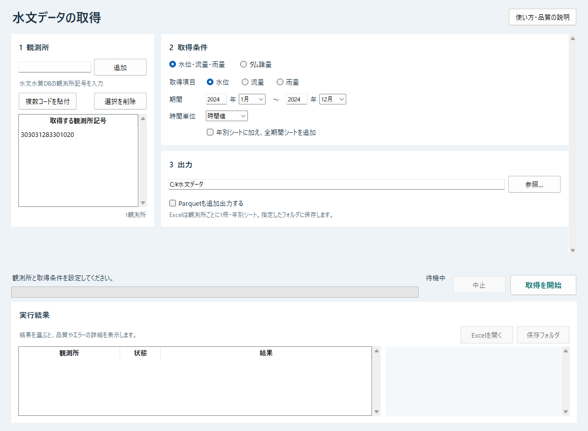

# 国土交通省 水文データ取得

国土交通省「水文水質データベース」の水位・流量・雨量、ダム諸量を取得して整理します。
観測所、取得条件、出力先を設定し、進捗と結果を同じ画面で確認できます。

### 起動画面

## 基本の使い方

1. 左の「観測所」に半角数字のコードを入力し、「追加」またはEnterで追加します。「複数コードを貼付」では改行・空白・カンマで区切ったコードをまとめて追加できます。
2. 右の「取得条件」で「水位・流量・雨量」または「ダム諸量」を選びます。
3. 対象に応じた項目と期間を設定します。
4. 「出力」で保存フォルダを入力するか「参照」で選びます。
5. 「取得を開始」を押します。結果行を選ぶと詳細が表示され、「Excelを開く」「保存フォルダ」で出力を確認できます。

詳しい説明は右上の「使い方・品質の説明」から開けます。小さい画面では上部の設定領域をスクロールできます。

## 取得条件

- 水位・流量・雨量: 1項目、開始年月〜終了年月、時間値/日値を選択します。
- ダム諸量: 開始日・終了日を `YYYY-MM-DD` 形式で指定します。流域平均雨量・貯水量・流入量・放流量・貯水率の時間値をまとめて取得します。31日を超える期間も自動分割します。

## オプション

- 「年別シートに加え、全期間シートを追加」: 水位等のExcelに「全期間」シートを追加します。
- 「Parquetも追加出力する」: Excelに加え、機械処理用のParquetも保存します。

## 出力

- 出力先: 画面で指定したフォルダ。初期値は `outputs/water_info/` の絶対パスです。
- 命名規則（例）:
  - 時刻データ: `..._WH.xlsx`（水位）/ `..._QH.xlsx`（流量）/ `..._RH.xlsx`（雨量）
  - 日データ: `..._WD.xlsx`（水位）/ `..._QD.xlsx`（流量）/ `..._RD.xlsx`（雨量）

!!! note "観測所名について"
    ファイル名の観測所名は、取得時にページから読み取り（読み仮名は除去）して付与されます。

ダムは指定先に観測所・期間ごとのサブフォルダを作成し、Excel1冊（年別シート・年別品質・品質一覧・出典・取得区間）、全期間CSV、品質JSON、原データを保存します。ダム用Parquetは専用の横持ち形式です。

## 結果と中止

- 「完了」は取得・出力が完了した状態です。水位等の値の欠測状況はExcelのsummaryを確認してください。
- ダムの「品質注意」は欠測等あり、「一部取得」は未取得区間ありを示します。
- 「失敗」は詳細欄に理由を表示します。設定を修正して再実行できます。
- 実行中は条件編集をロックします。「中止」で取得を止め、ダムは部分保存、水位等は完了済み観測所の出力が残ります。
- 同じ条件と保存先で実行すると同名の出力を更新します。ダムの保存済み原データは再利用できます。

### ダムの品質

| 品質 | 判定 |
| --- | --- |
| 有効 | 属性なし・有効な数値（0を含む） |
| 欠測 | 属性`$`、または数値なし |
| 未受信 | 属性`-` |
| 閉局 | 属性`#` |
| 不明属性 | 未対応の属性 |
| 行欠落 | 公開データに日時行がない |
| 取得失敗 | 通信・解析失敗または中止で未取得 |

属性を優先し、有効でない値は空欄にして原値・属性を残します。24時は翌日0時として保存し、ダムの年別シートは元日付の年で分類します。

## よくあるエラー

- **「指定期間に有効なデータが見つかりませんでした。」**  
  指定期間内にデータが存在しない可能性があります。まず短い期間で試してから期間を延ばしてください。
- **`[Error 13]`**  
  出力先のExcelが開かれていて上書きできない状態です。Excelを閉じて再実行してください。

